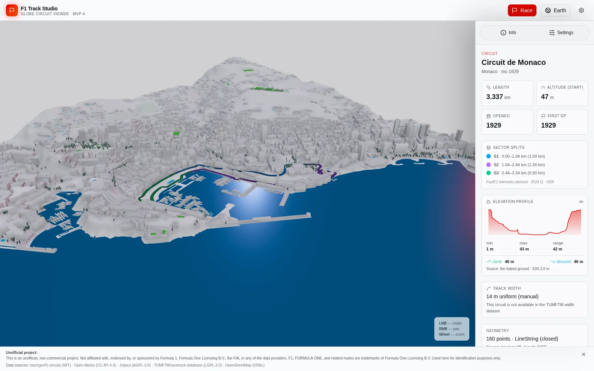
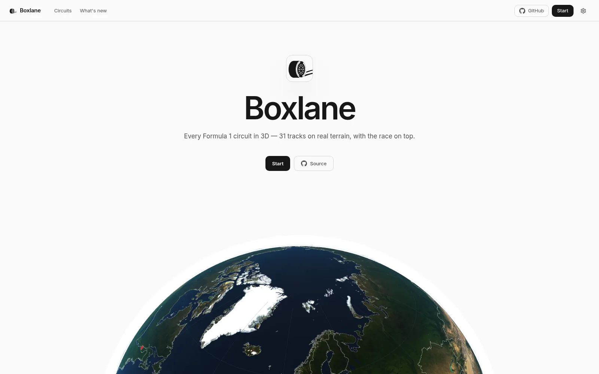
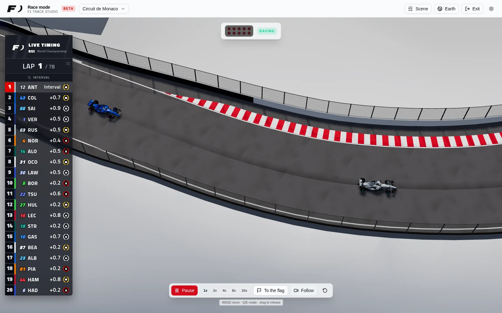

<div align="center">


<h1>Boxlane</h1>

<p align="center">
  <a href="https://makakashan.github.io/F1TrackViewer/">Live demo</a>
  ·
  <a href="./docs/architecture.md">Architecture</a>
  ·
  <a href="./docs/city-generation.md">How the city is baked</a>
  ·
  <a href="./docs/roadmap.md">Roadmap</a>
</p>

[](https://github.com/Makakashan/F1TrackViewer/actions/workflows/deploy.yml)
[](./LICENSE)

\


### Every Formula 1 circuit, in real-time 3D

Pick a circuit on the globe, walk round it on its real ground and among its real buildings,
then start a race and watch twenty cars drive the lap — all in the **browser**.
</div>

<div align="center">
    <table>
      <tr>
        <td colspan="2">
          
        </td>
      </tr>
      <tr>
        <td width="50%">
          
        </td>
        <td width="50%">
          
        </td>
      </tr>
    </table>
</div>
<div align="center">
    <sub>
      Monaco is baked from the IGN survey: every building at its measured height, every quay from the map.
    </sub>
</div>

> [!IMPORTANT]
> **Unofficial, non-commercial project.**
>
> Not affiliated with, endorsed by, or sponsored by Formula 1, Formula One Licensing B.V., the
> FIA, or any data provider. F1, FORMULA ONE and related marks are trademarks of Formula One
> Licensing B.V., used here for identification purposes only.

## Features

- **31 circuits** on a textured globe, with a searchable grid of outlines and a preview card — no runtime map APIs
- **Real elevation**, sector splits from session telemetry, and real per-point width where it is measured
- **A baked city** around the track: terrain, buildings at their surveyed heights, water, quays, parks and trees
- **Race mode**: kerbs from the centreline's curvature, painted grid, start lights and twenty cars on a deterministic simulation
- **A timing tower** with the running order, gaps, laps and fastest lap; 1x to 16x, or straight to the flag
- **Everything is a URL** — the same link shows the same circuit, the same camera and the same race
- Light and dark themes, English and Russian, and a quality setting that keeps phones at frame rate

## Quick start

Requirements: [Bun](https://bun.sh/) 1.1+ (or Node.js 20+) and a browser with WebGL.

```sh
bun install
bun run dev     # http://localhost:4000
```

Everything the app reads is committed under `public/`, so running it never touches a generator.

## Everything is a URL

```txt
/?track=es-1991&width=7&elevation=1&sectors=0&realwidth=0&environment=1&terrain=1&quality=auto
/?track=mc-1929&camera=iso
/?track=mc-1929&race=1
```

`/` with no `track` opens the globe. `camera` is `iso`, `top` or `side`; `quality` is `auto`,
`performance` or `quality`. `/admin` is a local tool for inspecting car models and the instanced
fleet.

## Scripts

| Command | Purpose |
|---|---|
| `bun run dev` | Dev server on port 4000 |
| `bun run build` | Production build |
| `bun run build:pages` | Static export for GitHub Pages |
| `bun run typecheck` | TypeScript, no emit |
| `bun run lint` | ESLint |
| `bun run test` | Invariant tests on synthetic ground — no network, milliseconds |
| `bun run circuits:generate` | Globe marker index |
| `bun run elevations:generate` | Static elevation profiles |
| `bun run widths:generate` | TUMFTM real-width profiles |
| `bun run environment:generate` | Diorama bundles (terrain, buildings, water, roads) |
| `bun run env:bake <circuitId>` | Bake a circuit's city into `far`, `city` and `core` GLBs |
| `bun run env:bake:all` | Bake every circuit the app lists, resumable with `--only` and `--skip-baked` |
| `bun run env:audit <circuitId>` | Check a baked city against its budgets and invariants |
| `bun run cars:teams` | Team liveries from the base car model |
| `bun run cars:lods` | Reduced-triangle car models |
| `bun run cars:generate` | Car manifest |
| `bun run race:laptimes` | Compare the speed model's ideal lap against real pole laps |
| `bun run race:audit` | Headless race, checking the field stays sane |
| `bun run race:kerbs` | Corner detection coverage across the calendar |
| `bun run race:gaps` | Timing-tower gaps against a headless race |

The generators need Python with `fastf1` and `pandas` for the telemetry-derived sector splits.

## Layout

```txt
src/
  app/                       Next.js routes: / and /admin
  components/
    globe/                   start screen, Earth, markers, circuit preview, what's new
    track/                   viewer UI — the scene's floating cards and dock, settings
    race/                    race HUD — timing tower, controls, results, lights
    three/                   every R3F component: track mesh, cars, camera rig,
                             baked city, environment layer, studio stage
    admin/                   model and fleet inspection tools
    ui/                      shadcn/ui primitives
  hooks/                     circuit index, track data, race simulation, lights
  lib/
    track/                   centerline geometry, curvature, corners, kerbs,
                             apron, width, markers, start/finish, elevation
    race/                    simulation, speed profile, grid, drivers, teams
    cars/                    car dimensions, mesh building, model stats
    env/                     diorama bundles, terrain sampling, palette
    (root)                   geo-utils, url-state, i18n, scene-config, prefs
scripts/
  env/                       the city bake: raster, terrain, coast, buildings, props
public/
  circuits-index.json        globe marker index
  elevations/                static elevation profiles
  environments/              per-circuit diorama bundles and baked cities
  track-markers/             sector splits, start/finish, lap length
  track-widths/              TUMFTM width profiles
  cars/                      car models per team, with LODs
  textures/earth/            Earth textures
  whats-new/                 screenshots for the what's-new panel
docs/
  architecture.md            how the app runs
  project-map.md             where things live, by symptom
  city-generation.md         why the bake is shaped this way, decision by decision
  scene-goals.md             what the baked scene must be, and its invariants
  roadmap.md                 what is next, in priority order
  history/                   what was already built, phase by phase
```

## Data sources

| Source | Used for | License |
|---|---|---|
| [bacinger/f1-circuits](https://github.com/bacinger/f1-circuits) | Track geometry and metadata | MIT |
| [FastF1](https://github.com/theOehrly/Fast-F1) | Sector splits from session telemetry | MIT |
| [IGN Géoplateforme](https://geoservices.ign.fr/) | Terrain and building heights for the baked cities | Licence Ouverte 2.0 |
| [Open-Meteo](https://open-meteo.com/en/docs#elevation-api) | Elevation data | CC-BY 4.0 |
| [OpenTopoData](https://opentopodata.org/) | Elevation fallback | CC-BY 4.0 |
| [TUMFTM/racetrack-database](https://github.com/TUMFTM/racetrack-database) | Real per-point track width | LGPL-3.0 |
| [OpenStreetMap](https://www.openstreetmap.org/copyright) | Buildings, coast, roads and landuse | ODbL |
| [Jolpica](https://github.com/jolpica/jolpica-f1) | Driver and team data | AGPL-3.0 |

## License

MIT. See [LICENSE](./LICENSE).
